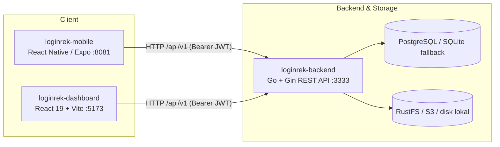
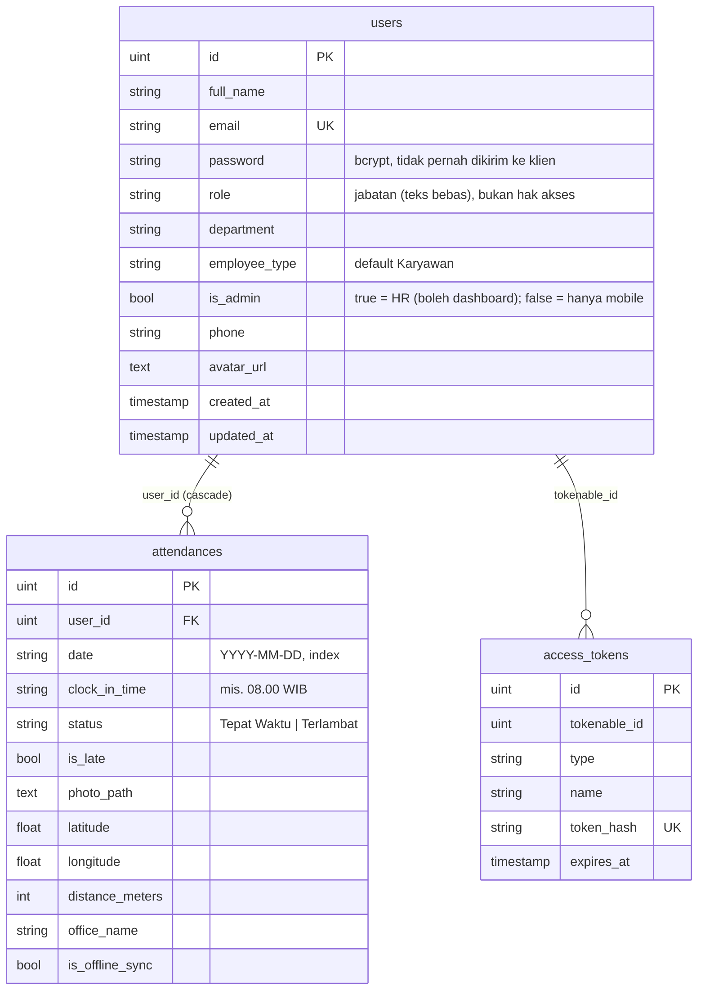

# Arsitektur — loginrek

## Gambaran sistem



| Komponen | Peran |
| -------- | ----- |
| `loginrek-backend` | REST API (Gin + GORM). JWT, bcrypt, AutoMigrate, seeder akun uji, kompresi foto ke WebP. PostgreSQL dengan fallback otomatis ke SQLite (`tmp/db.sqlite3`); RustFS/S3 dengan fallback ke `public/uploads/`. |
| `loginrek-dashboard` | SPA untuk HR/Admin: monitoring absensi, peta Leaflet, manajemen karyawan, pengaturan. |
| `loginrek-mobile` | Aplikasi karyawan: login, absen GPS + selfie, riwayat, mode offline-sync. |

Mobile dan dashboard hanya bicara dengan REST API (`docs/API.md`). Tidak ada akses langsung
ke database/bucket.

## Autentikasi

Satu mekanisme untuk semua klien: `POST /auth/login` → JWT (HS256, 30 hari) → `Authorization: Bearer`.
Kata sandi di-hash bcrypt dan hanya diverifikasi server; tidak ada akun/kata sandi di kode klien.

| Klien | Pengguna | Penyimpanan token |
| ----- | -------- | ----------------- |
| Dashboard | HR/admin (`is_admin = true`) | `localStorage` (`admin_token`); diverifikasi `GET /auth/me` saat dibuka |
| Mobile | Karyawan (dan HR) | `expo-secure-store` (Keychain/Keystore) |

**Peran** = satu kolom `users.is_admin` (boolean). `true` = HR, boleh dashboard dan mobile; `false` =
karyawan, hanya mobile (endpoint dashboard membalas 403 dan UI dashboard menolak login). Akun HR pertama
dibuat seeder dari `SEED_ADMIN_EMAIL`/`SEED_ADMIN_PASSWORD` saat tabel `users` masih kosong; tidak ada API
untuk membuat admin. Kolom `role` hanyalah jabatan (teks bebas) dan tidak mempengaruhi hak akses.
Daftar hak akses per endpoint: `docs/API.md`.

**Offline (mobile)**: login pertama wajib online. JWT disimpan di SecureStore dan dipulihkan saat aplikasi
dibuka, sehingga HP offline tetap bisa absen — absen masuk antrean lokal (`sync-store`) dan dikirim dengan
JWT yang sama saat koneksi kembali (`isOfflineSync: true`). Server membalas 401 → mobile membersihkan sesi
dan meminta login ulang (antrean tidak dibuang).

## Backend

Struktur direktori: lihat [README](../README.md#backend-loginrek-backend).

Konfigurasi lewat environment — lihat `.env.example` di root.

## Skema database

Sumber kebenaran: `loginrek-backend/internal/domain/models.go` (AutoMigrate). Perbarui
bagian ini di PR yang sama dengan perubahan model.



Catatan: belum ada unique constraint `(user_id, date)` — duplikat dicegah di handler.
Tabel `access_tokens` ada di model tetapi autentikasi memakai JWT stateless.

## Mobile

### Lapisan
```
src/app (route)  ->  hook / logic  ->  src/lib/api.ts  ->  REST API
                          ├─ src/lib/token-storage.ts (expo-secure-store)
                          └─ device API: expo-location, expo-camera
```

### Base URL API (`src/config/env.ts`)

| Situasi | URL |
| ------- | --- |
| `EXPO_PUBLIC_API_URL` di-set (`.env.local` / `eas.json`) | nilai tersebut |
| Dev via Expo Go, satu Wi-Fi dengan laptop | otomatis `http://<IP laptop>:3333/api/v1` |
| Emulator Android / iOS simulator | `10.0.2.2` / `localhost` |
| Build production | `https://loginrek-api.bidtech.co.id/api/v1` (di `eas.json`) |

Mode `--tunnel` tidak meneruskan port API — set `EXPO_PUBLIC_API_URL` ke URL tunnel API.

### Alur utama
1. Root layout → baca token → `GET /auth/me`; 401 → hapus token → login.
2. Login → `POST /auth/login` → simpan token → Beranda.
3. Beranda → `GET /attendances/today`, tombol Absen.
4. Absen → izin lokasi + kamera → `POST /attendances/check-in`. Bila offline, antrean
   disimpan lalu disinkronkan di latar belakang (`isOfflineSync: true`).
5. Riwayat, Profil.

### Build & rilis (EAS)

| Profil `eas.json` | Untuk |
| ----------------- | ----- |
| `development` | dev client (library native di luar Expo Go) |
| `preview` | uji internal — APK Android |
| `production` | App Store / Play Store (`autoIncrement`) |

```bash
cd loginrek-mobile
npx eas-cli@latest build --profile preview --platform android
```
Rilis iOS butuh Apple Developer Program. CI mobile (EAS) belum ada.

## Deploy

`docker-compose.yml` = infra dev (PostgreSQL + RustFS). `docker-compose.prod.yml` = stack
penuh di VPS, di belakang **Traefik** (jaringan eksternal `traefik-network`, entrypoint
`websecure`, resolver `letsencrypt`), dikirim oleh `.github/workflows/loginrek.yml`.

| Domain | Service | Keterangan |
| ------ | ------- | ---------- |
| `loginrek.bidtech.co.id` | `lr-dashboard` | dashboard HR (SPA statis Nginx) |
| `loginrek-api.bidtech.co.id` | `lr-backend` | REST API + foto (`/uploads/*`); rate limit 30 req/s per IP (`CF-Connecting-IP`) |

- PostgreSQL dan RustFS hanya di jaringan `internal` (tidak diekspos ke Traefik). Foto disajikan
  backend lewat `GET /uploads/*key` yang membaca dari RustFS.
- Tidak ada port aplikasi yang dipublikasikan.
  Konsol RustFS hanya lewat SSH tunnel (`127.0.0.1:${RUSTFS_CONSOLE_HOST_PORT}`).
- Nama service berawalan `lr-` karena menjadi alias DNS di `traefik-network` yang dipakai
  bersama project lain.
- Image: `loginrek-backend/Dockerfile` (binary Go statis di alpine, non-root, `/health` untuk healthcheck) dan
  `loginrek-dashboard/Dockerfile` (build Vite → Nginx; fallback `index.html` untuk React Router).
- URL API dibakar ke bundle dashboard saat build lewat build-arg `VITE_API_URL` (wajib; CI: env `API_URL` di
  workflow, compose: `https://${API_DOMAIN}`).
- Production tidak pernah jatuh ke SQLite: bila PostgreSQL tidak terjangkau, backend berhenti dan container
  di-restart. Backend juga menunggu RustFS siap (cek bucket dicoba ulang ±30 detik) sebelum memakai disk lokal.
- Variabel: `.env.example`.
