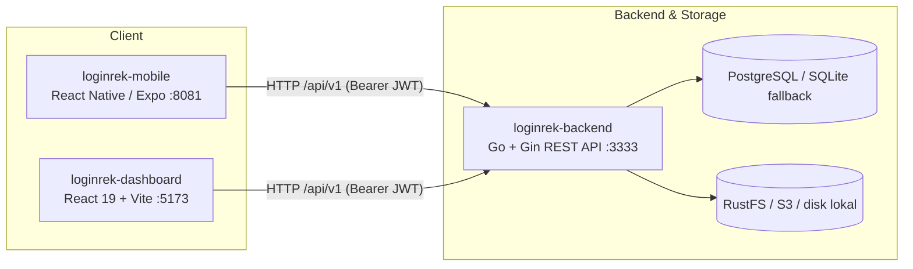
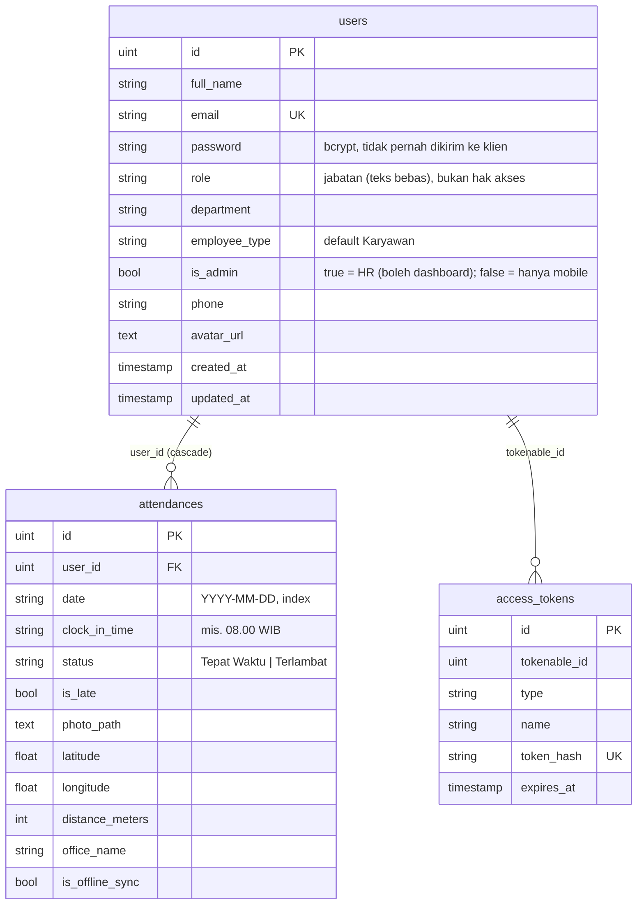

# Arsitektur — SapaKerja

## Gambaran sistem



| Komponen | Peran |
| -------- | ----- |
| `loginrek-backend` | REST API (Gin + GORM). JWT, bcrypt, AutoMigrate, seeder akun uji, kompresi foto ke WebP. PostgreSQL dengan fallback otomatis ke SQLite (`tmp/db.sqlite3`); RustFS/S3 dengan fallback ke `public/uploads/`. |
| `loginrek-dashboard` | SPA untuk HR/Admin: monitoring absensi, peta Leaflet, manajemen karyawan, pengaturan. |
| `loginrek-mobile` | Aplikasi karyawan: login, absen GPS + selfie, riwayat, mode offline-sync. |

Mobile dan dashboard hanya bicara dengan REST API (`docs/API.md`). Tidak ada akses langsung
ke database/bucket.

## Autentikasi

Satu mekanisme untuk semua klien: `POST /auth/login` → JWT (HS256, 30 hari) → `Authorization: Bearer`.
Kata sandi di-hash bcrypt dan hanya diverifikasi server; tidak ada akun/kata sandi di kode klien.

| Klien | Pengguna | Penyimpanan token |
| ----- | -------- | ----------------- |
| Dashboard | HR/admin (`is_admin = true`) | `localStorage` (`admin_token`); diverifikasi `GET /auth/me` saat dibuka |
| Mobile | Karyawan (dan HR) | `expo-secure-store` (Keychain/Keystore) |

**Peran** = satu kolom `users.is_admin` (boolean). `true` = HR, boleh dashboard dan mobile; `false` =
karyawan, hanya mobile (endpoint dashboard membalas 403 dan UI dashboard menolak login). Akun HR pertama
dibuat seeder dari `SEED_ADMIN_EMAIL`/`SEED_ADMIN_PASSWORD` saat tabel `users` masih kosong; tidak ada API
untuk membuat admin. Kolom `role` hanyalah jabatan (teks bebas) dan tidak mempengaruhi hak akses.
Daftar hak akses per endpoint: `docs/API.md`.

**Offline (mobile)**: login pertama wajib online. JWT disimpan di SecureStore dan dipulihkan saat aplikasi
dibuka, sehingga HP offline tetap bisa absen — absen masuk antrean lokal (`sync-store`) dan dikirim dengan
JWT yang sama saat koneksi kembali (`isOfflineSync: true`). Server membalas 401 → mobile membersihkan sesi
dan meminta login ulang (antrean tidak dibuang).

## Backend

Struktur direktori: lihat [README](../README.md#backend-loginrek-backend).

Konfigurasi lewat environment — lihat `.env.example` di root.

## Skema database

Sumber kebenaran: `loginrek-backend/internal/domain/models.go` (AutoMigrate). Perbarui
bagian ini di PR yang sama dengan perubahan model.



Catatan: belum ada unique constraint `(user_id, date)` — duplikat dicegah di handler.
Tabel `access_tokens` ada di model tetapi autentikasi memakai JWT stateless.

## Mobile

### Lapisan
```
src/app (route)  ->  hook / logic  ->  src/lib/api.ts  ->  REST API
                          ├─ src/lib/token-storage.ts (expo-secure-store)
                          └─ device API: expo-location, expo-camera
```

### Base URL API (`src/config/env.ts`)

| Situasi | URL |
| ------- | --- |
| `EXPO_PUBLIC_API_URL` di-set (`.env.local` / `eas.json`) | nilai tersebut |
| Dev via Expo Go, satu Wi-Fi dengan laptop | otomatis `http://<IP laptop>:3333/api/v1` |
| Emulator Android / iOS simulator | `10.0.2.2` / `localhost` |
| Build production | `https://api.sapakerja.com/api/v1` (di `eas.json`) |

Mode `--tunnel` tidak meneruskan port API — set `EXPO_PUBLIC_API_URL` ke URL tunnel API.

### Alur utama
1. Root layout → baca token → `GET /auth/me`; 401 → hapus token → login.
2. Login → `POST /auth/login` → simpan token → Beranda.
3. Beranda → `GET /attendances/today`, tombol Absen.
4. Absen → izin lokasi + kamera → `POST /attendances/check-in`. Bila offline, antrean
   disimpan lalu disinkronkan di latar belakang (`isOfflineSync: true`).
5. Riwayat, Profil.

### Build & rilis (EAS)

| Profil `eas.json` | Untuk |
| ----------------- | ----- |
| `development` | dev client (library native di luar Expo Go) |
| `preview` | uji internal — APK Android |
| `production` | App Store / Play Store (`autoIncrement`) |

```bash
cd loginrek-mobile
npx eas-cli@latest build --profile preview --platform android
```
Rilis iOS butuh Apple Developer Program. Build binary (EAS) masih manual; update JavaScript-nya dirilis otomatis lewat
OTA (bagian berikut). <!-- DIUBAH (OTA): kalimat "CI mobile (EAS) belum ada" diganti. -->

### Update OTA (expo-updates, server sendiri)
<!-- DIUBAH (OTA): subbagian baru. Menggantikan server update EAS (u.expo.dev). -->

JS + aset dari JS bisa diperbarui tanpa build baru. Perubahan native tidak bisa dan **ditolak otomatis** oleh CI.

```
commit di loginrek-mobile/ (bukan .md) ──► job `changes` (mobile=true)
        └─► job `publish-ota`: env dari eas.json → cek native → expo export → manifest + tanda tangan
              → tar → SCP ke VPS → ekstrak ke $DEPLOY_PATH/updates → pindahkan latest.json (terakhir)
HP ──GET /updates/manifest──► Traefik ──► lr-backend (internal/updates, baca /data/updates) ──► manifest + expo-signature
HP ──GET /updates/files/…──► bundle & aset (immutable)
```

- **Pemisahan job** (`.github/workflows/loginrek.yml`): `changes` membandingkan push. `server` (backend, dashboard,
  `docker-compose.prod.yml`, `.env.example`, workflow) → check/build/package/deploy. `mobile` (`loginrek-mobile/**`, kecuali `.md`)
  → `publish-ota`. Keduanya paralel dan tidak saling memicu; antrean per job (`deploy-production`, `ota-production`).
  Manual: Run workflow → `target` = `deploy` atau `ota`.
- **Tata letak di VPS** (`$DEPLOY_PATH`, default `/opt/loginrek`):

  | Di VPS | Di container backend | Isi |
  | ------ | -------------------- | --- |
  | `updates/` | `/data/updates` (read-only, `UPDATES_DIR`) | `<channel>/<runtime>/latest.json` + `<publishId>/` (`manifest.<platform>.json`, `.sig`, `_expo/…`, `assets/…`) |
  | `ota-state/<channel>/<runtime>.native.txt` | – (tidak di-mount) | acuan sidik jari native untuk pemeriksaan |

  Folder `updates/` harus terbaca container (UID 10001): folder 755, berkas 644 (job menjalankan `chmod -R a+rX`).
  Tersisa 10 rilis terakhir per runtime; sisanya dihapus job. Pointer `latest.json` dipindah paling akhir (atomik).
- **Code signing**: sertifikat publik `loginrek-mobile/certs/certificate.pem` ditanam di app (`app.json` → `updates.codeSigningCertificate`,
  `keyid: main`, `alg: rsa-v1_5-sha256`). Private key **tidak** di repo: lokal di `loginrek-mobile/keys/` (di-ignore) dan GitHub secret
  `UPDATE_SIGNING_KEY` (Environment `production`). Hanya CI yang menandatangani; backend cuma menyajikan `.sig`. Mengganti key/sertifikat = build baru.
- **Pemeriksaan native**: sidik jari = library native produksi di `node_modules`, `app.json` (tanpa `version`/`extra`), isi berkas yang dirujuk
  config (ikon, splash, ikon/suara notifikasi, `google-services.json`, `GoogleService-Info.plist`, sertifikat) dan `patches/`.
  Dibandingkan dengan `ota-state/…native.txt`. Beda atau acuan belum ada → job gagal, tidak ada OTA.
- **Channel & runtime**: header `expo-channel-name: production` (`app.json`, cocok dengan `eas.json` profil `production`), runtime = `version`
  (`runtimeVersion.policy: appVersion`). Profil `development`/`preview`/`production-internal` punya channel sendiri dan **tidak** menerima OTA ini.
  Nilai `EXPO_PUBLIC_*` diambil dari `eas.json` (`build.production.env`) agar bundle OTA identik dengan build production.
- **Penanda rilis**: setiap rilis punya `publishId` (`<timestamp UTC>-<SHA 7 karakter>`, nama folder di `updates/`). CI menaruhnya di
  `manifest.metadata.publishId` (ikut ditandatangani). Layar Profil mobile menampilkan lingkungan, `v<version> Build (<nomor>)`, dan
  `publishId` (atau "Bawaan build" bila belum ada update OTA) lewat `src/lib/app-info.ts`. Rilis sebelum penanda ini ditambahkan
  tidak punya `publishId`; aplikasi menampilkan 8 karakter pertama `updateId` sebagai gantinya.

**Cara rilis** — otomatis saat commit di `loginrek-mobile/` masuk `main`. Pantau di Actions → `loginrek` → `Publish OTA`.

**Setelah `eas build` baru terpasang** (atau `version` naik): jalankan manual Actions → `loginrek` → Run workflow → `target=ota` + centang
`rebase_native`. Ini menyimpan kondisi native saat ini sebagai acuan baru dan sekaligus merilis update. Sebelum itu, OTA otomatis gagal
dengan pesan "Belum ada acuan native" (disengaja).

**Rollback** — rilis update **baru** dari commit yang sehat (revert commit lalu push, atau Run workflow dari commit itu). Jangan hanya
mengembalikan `latest.json` ke ID lama: klien yang sudah mengunduh update baru tidak akan turun ke ID yang lebih lama.

**Secrets** (Environment `production`): `UPDATE_SIGNING_KEY` (isi `keys/private-key.pem`) + `VPS_HOST`, `VPS_SSH_KEY` (wajib),
`VPS_USER`, `VPS_PORT`, `VPS_DEPLOY_PATH` (opsional) yang sudah dipakai deploy. Contoh tanpa mencetak key:
`gh secret set UPDATE_SIGNING_KEY --env production < loginrek-mobile/keys/private-key.pem`.

**Uji di HP**: pasang build `production` yang memuat sertifikat ini, rilis satu update, lalu buka-tutup aplikasi dua kali
(buka pertama mengunduh, buka kedua menjalankan). Di VPS: `curl -i -H 'expo-platform: ios' -H 'expo-runtime-version: 1.0.2'
-H 'expo-channel-name: production' https://api.sapakerja.com/updates/manifest` (204 = belum ada update).

## Deploy

`docker-compose.yml` = infra dev (PostgreSQL + RustFS). `docker-compose.prod.yml` = stack
penuh di VPS, di belakang **Traefik** (jaringan eksternal `traefik-network`, entrypoint
`websecure`, resolver `letsencrypt`), dikirim oleh `.github/workflows/loginrek.yml`.

| Domain | Service | Keterangan |
| ------ | ------- | ---------- |
| `sapakerja.com` | `lr-dashboard` | dashboard HR (SPA statis Nginx) |
| `loginrek.bidtech.co.id` (`DASHBOARD_DOMAIN_LEGACY`) | `lr-dashboard` | domain lama dashboard, dilayani langsung (tanpa redirect) |
| `api.sapakerja.com` | `lr-backend` | REST API + foto (`/uploads/*`) + update OTA (`/updates/*`); rate limit 30 req/s per IP (`CF-Connecting-IP`) |
| `loginrek-api.bidtech.co.id` (`API_DOMAIN_LEGACY`) | `lr-backend` | domain lama API; router `lr-api` yang sama, dilayani langsung |

**Dua domain, tanpa redirect.** Router `lr-dashboard` dan `lr-api` memakai `Host(baru) || Host(lama)`; `CORS_ORIGINS` memuat kedua origin dashboard. Domain lama TIDAK di-redirect di Cloudflare: HP dengan build lama masih memanggil `loginrek-api.bidtech.co.id`, dan redirect mengubah POST menjadi GET serta membuang header `Authorization` saat lintas host. Dashboard hanya punya satu `VITE_API_URL` (`https://api.sapakerja.com`), termasuk saat dibuka lewat domain lama. Domain lama boleh dipensiunkan setelah tidak ada HP dengan build lama.

<!-- DIUBAH (OTA): `/updates/*` dan volume `./updates` ditambahkan. Saat ini /updates masih memakai router `lr-api` (rate limit + kompresi Traefik yang sama). -->
- `lr-backend` me-mount `./updates` (di samping compose) ke `/data/updates` **read-only**; `UPDATES_DIR=/data/updates`. Lihat "Update OTA".

- PostgreSQL dan RustFS hanya di jaringan `internal` (tidak diekspos ke Traefik). Foto disajikan
  backend lewat `GET /uploads/*key` yang membaca dari RustFS.
- Tidak ada port aplikasi yang dipublikasikan.
  Konsol RustFS hanya lewat SSH tunnel (`127.0.0.1:${RUSTFS_CONSOLE_HOST_PORT}`).
- Nama service berawalan `lr-` karena menjadi alias DNS di `traefik-network` yang dipakai
  bersama project lain.
- Image: `loginrek-backend/Dockerfile` (binary Go statis di alpine, non-root, `/health` untuk healthcheck) dan
  `loginrek-dashboard/Dockerfile` (build Vite → Nginx; fallback `index.html` untuk React Router).
- URL API dibakar ke bundle dashboard saat build lewat build-arg `VITE_API_URL` (wajib; CI: env `API_URL` di
  workflow, compose: `https://${API_DOMAIN}`).
- Production tidak pernah jatuh ke SQLite: bila PostgreSQL tidak terjangkau, backend berhenti dan container
  di-restart. Backend juga menunggu RustFS siap (cek bucket dicoba ulang ±30 detik) sebelum memakai disk lokal.
- Variabel: `.env.example`.
