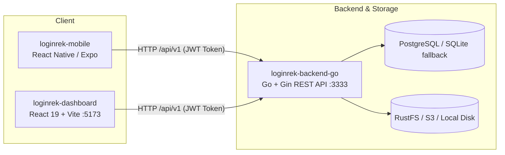

# Arsitektur — Login Rek

## Gambaran Sistem

### Komponen Sistem:
1. **`loginrek-backend-go`** (Port 3333):
   - REST API engine berkinerja tinggi menggunakan Go Gin & GORM.
   - Mengelola autentikasi JWT, password hashing bcrypt, AutoMigrate skema database (PostgreSQL dengan fallback otomatis ke SQLite lokal), dan kompresi foto WebP.
2. **`loginrek-dashboard`** (Port 5173):
   - Frontend Single Page Application (SPA) berbasis React 19 + Vite.
   - Digunakan oleh HR/Admin untuk live monitoring absensi, peta interaktif Leaflet, manajemen data karyawan, dan konfigurasi radius/jam kerja.
3. **`loginrek-mobile`** (Port 8081):
   - Aplikasi mobile untuk karyawan absensi berbasis React Native + Expo.
   - Dilengkapi validasi lokasi GPS, verifikasi foto selfie, dan mode offline sync.

---

## Autentikasi

| Klien | Pengguna | Mekanisme |
| ----- | -------- | --------- |
| **Web Dashboard** | Admin / HR | JWT Token (`admin_user` di localStorage) |
| **Mobile App** | Karyawan / Pegawai | JWT Token (Bearer token di SecureStore / Storage) |
